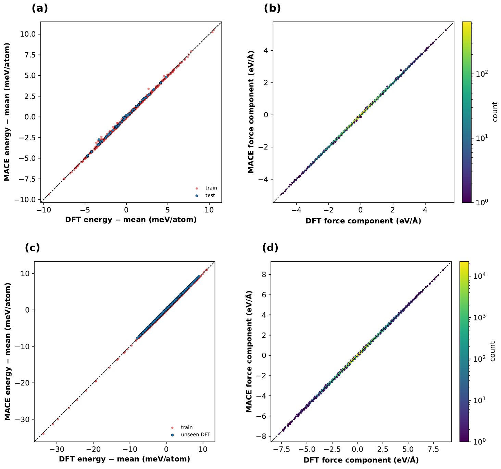

# Gas Diffusion in UiO-66 and MIL-101(Cr): Classical Force Field and Machine-Learned Interatomic Potential

This repository contains the LAMMPS input scripts, structure files, MACE potentials and training data, analysis notebooks, and computed data that accompany the article

> S. Jalalmanesh, S. M. Vaez Allaei, and M. Sahimi, *Molecular Dynamics Simulation of Gas Diffusion in Metal-Organic Frameworks Based on a Classical Force Field and Machine-Learned Interatomic Potential*, Microporous and Mesoporous Materials (under review).

<p align="center">
  
</p>

## Overview

The self-diffusivities of CO₂, N₂, and H₂O in two metal-organic frameworks, UiO-66 and MIL-101(Cr), were computed by molecular dynamics (MD) simulation as functions of the loading. Two descriptions of UiO-66 were used:

* **UFF**: the Universal Force Field with DDEC charges, for UiO-66 and MIL-101(Cr), with the loaded configurations generated by staged MD-GCMC;
* **MACE**: machine-learned interatomic potentials trained on PBE-D3(BJ) ab initio MD data of the UiO-66 primitive cell with 1 to 7 guest molecules, one potential for N₂ and one for CO₂.

The repository also contains the coadsorption of CO₂ and H₂O in UiO-66, the validation of the MACE potentials (accuracy, phonons, equation of state, and energy conservation), and the structural characterization of the two frameworks (XRD, RDF, geometric surface area, FTIR, and pore-size distribution).

## Repository structure

```
lammps/
  framework/  relaxation of the empty frameworks
  gcmc/       staged MD-GCMC loading of CO2, N2, and H2O in UiO-66 and MIL-101(Cr), and CO2/H2O coadsorption in UiO-66
  msd_uff/    mean-squared displacements with the UFF (single gases and the CO2/H2O mixture)
  mace/       mean-squared displacements and energy-conservation test with the MACE potentials
mace/
  vasp/       VASP input files of the reference DFT calculations
  datasets/   training and test sets (extended XYZ) of the N2 and CO2 potentials
  models/     trained MACE potentials (ASE and LAMMPS versions)
  notebooks/  preparation of the datasets and validation of the potentials
  train_mace.sh  training command and settings
structures/   UiO-66 and MIL-101(Cr) data files (UFF/DDEC), UiO-66 primitive cells with guests (MACE), and molecule files
analysis/     MSD analysis and self-diffusivities, structural characterization of the frameworks
data/
  computed/   self-diffusivities and other values reported in the article
docs/         figures used in this page
```

Each folder contains a README that describes its files.

## Models and methods

| Component | Model |
|---|---|
| UiO-66 framework (UFF) | UFF with DDEC charges, 3,648-atom cell |
| MIL-101(Cr) framework | UFF4MOF with DDEC charges, 3,604-atom primitive cell |
| UiO-66 framework (MACE) | MACE potentials (5.0 Å cutoff, 128 channels, 2 interactions), 114-atom primitive cell |
| CO₂ | TraPPE, rigid, three sites |
| N₂ | rigid, two sites with the TraPPE Lennard-Jones parameters, no partial charges |
| H₂O | SPC/E, rigid |
| Electrostatics (UFF) | Ewald summation, accuracy 10⁻⁴ |
| Cutoff (UFF) | 14.5 Å for Lennard-Jones and real-space Coulomb interactions; Lorentz-Berthelot mixing |
| Reference DFT | VASP, PBE-D3(BJ), 520 eV, Γ point |

Full details are given in Section 2 of the article.

## Software requirements

* LAMMPS with the MOLECULE, EXTRA-MOLECULE, KSPACE, MC, and RIGID packages (UFF simulations), and with the MACE pair style and KOKKOS (MACE simulations)
* VASP (reference DFT data only)
* Python 3.9 or later with the packages listed in `requirements.txt`

```bash
pip install -r requirements.txt
```

## Workflow

**UFF simulations**

1. **Framework.** Relax the empty framework with `lammps/framework/in.relax_framework`.
2. **Loading.** Generate the loaded configurations with the staged MD-GCMC scripts in `lammps/gcmc/`, choosing the target numbers of molecules and the reservoir pressure of each stage. For the CO₂/H₂O mixture, load water first at the chosen relative humidity and then run `in.gcmc_UiO66_H2O_CO2`.
3. **Diffusion.** Run the MSD scripts in `lammps/msd_uff/` from each loaded snapshot, with independent iterations.
4. **Analysis.** Compute the self-diffusivities with `analysis/msd_diffusion_analysis.ipynb`.

**MACE simulations**

1. **Reference data.** Run ab initio MD of the UiO-66 primitive cell with 1 to 7 guest molecules, single points of short-range contact configurations, and ab initio MD of the isolated guest, with the inputs in `mace/vasp/`.
2. **Datasets.** Convert the VASP output into training and test sets with `mace/notebooks/prepare_dataset.ipynb` (the sets with two guest molecules, used for the tests reported in the article, are in `mace/datasets/`).
3. **Training.** Train the potential with `mace/train_mace.sh` and export it for LAMMPS (the trained potentials are in `mace/models/`).
4. **Validation.** Run `mace/notebooks/validation_N2.ipynb` and `validation_CO2.ipynb` (accuracy, phonons, equation of state) and `lammps/mace/in.nve_mace` (energy conservation).
5. **Diffusion.** Run `lammps/mace/in.msd_mace` for each loading, and analyze the output with `analysis/msd_diffusion_analysis.ipynb`.

The data files, loadings, pressures, seeds, and other system-specific quantities are placeholders in the USER INPUTS block at the top of each script, and must be set by the user. All the values reported in the article are given in `data/computed/`.

## Citation

If you use these files, please cite the article above. A machine-readable citation is provided in `CITATION.cff`.

## License

The code (LAMMPS input scripts, training script, and notebooks) is released under the MIT License (`LICENSE`). The data in `data/`, `mace/datasets/`, and `mace/models/` are released under the Creative Commons Attribution 4.0 International License (`data/LICENSE`).

## Contact

Muhammad Sahimi, Mork Family Department of Chemical Engineering and Materials Science, University of Southern California (moe@usc.edu)
